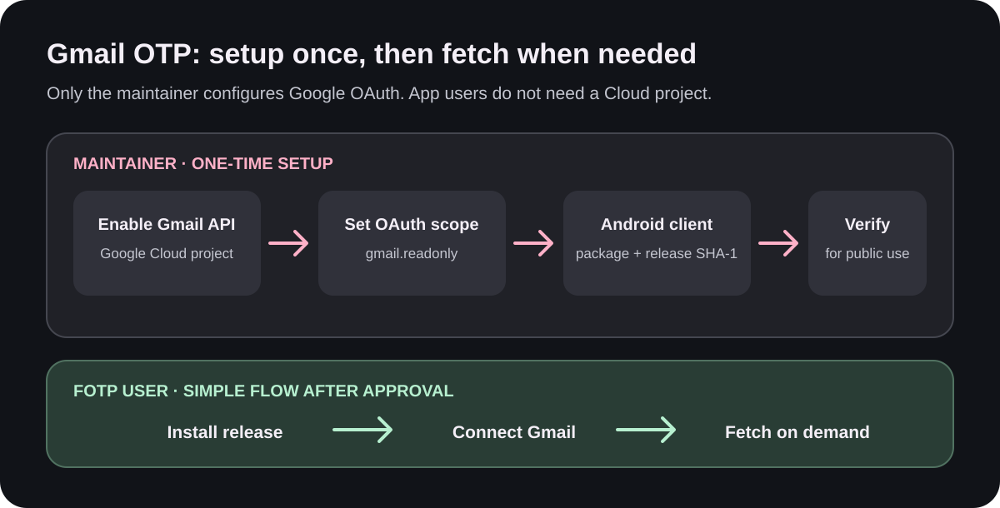
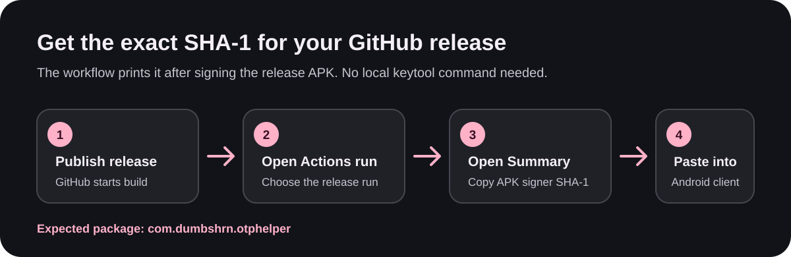

# FOTP (Fetch-OTP)

FOTP (Fetch-OTP) is an open-source app that detects one-time codes in SMS and notifications and copies them automatically. You can also fetch OTPs on demand from Gmail using the Quick Settings tile or the Settings screen.

FOTP is a modified fork of [OTP Helper](https://github.com/jd1378/otphelper), originally created by [jd1378](https://github.com/jd1378). This fork retains the upstream project’s AGPL-3.0 license, copyright and attribution notices, and translator credits. See [LICENSE](LICENSE) for the complete license and the source in this repository for the corresponding source of this modified version.

SMS and notification detection work locally. The optional Gmail feature uses Gmail's read-only API only when you explicitly fetch; it checks up to 100 recent inbox messages from the last seven days and does not monitor Gmail in the background or save message bodies. The detected code is handled using your existing copy, notification, and history preferences.

Download the test APK from the [GitHub Actions workflow artifacts](https://github.com/dumbshrn/FOTP/actions). When the release signing secrets are configured, the workflow also uploads a signed release APK.

## Gmail setup: quick guide



### For FOTP users

After the FOTP OAuth app is approved for public use, you do **not** need to create a Google Cloud project, add yourself as a test user, or enter a SHA-1. Install the APK from the [GitHub Releases page](https://github.com/dumbshrn/FOTP/releases), open **Settings → Gmail OTP**, connect your Google account, and tap **Fetch OTP from Gmail** when you need a code.

If the app is still in Google OAuth **Testing**, only accounts the maintainer added as test users can connect. There is no user-side setting that bypasses this limit.

### For the maintainer: one-time OAuth setup

You only need to do these steps for the FOTP OAuth project. Keep the app in **Testing** while developing; add only the accounts you control as test users.

1. In [Google Cloud Console](https://console.cloud.google.com/), select the OAuth project and enable **Gmail API** under **APIs & Services → Library**.
2. In **Google Auth Platform**, configure the app name, support email, developer contact, and an **External** audience. In **Data Access**, add `https://www.googleapis.com/auth/gmail.readonly`.
3. Under **Audience → Test users**, add your own accounts for testing. These test users are not public access; general users need the app's OAuth verification to be approved.
4. Create an **Android** OAuth client with package name `com.dumbshrn.otphelper` and the SHA-1 for the signed release APK. Create the signed GitHub release as described below, then copy the fingerprint from that run's **Release APK OAuth identity** summary. If testing with the unsigned/debug CI APK, its debug SHA-1 is different and is shown by the [Build artifact workflow](https://github.com/dumbshrn/FOTP/actions/workflows/build_artifact.yml).
5. Before enabling Gmail for everyone, complete Google's [OAuth verification process](https://support.google.com/cloud/answer/13461325?hl=en). `gmail.readonly` is a restricted scope, so a public release that requests it is subject to Google's verification and data-use requirements. The project can remain in Testing for private testing, but other accounts will not be able to connect.



### Create a GitHub release and get its SHA-1

1. Add the four signing secrets in **GitHub repository → Settings → Secrets and variables → Actions**: `ANDROID_SIGNING_KEY` (base64-encoded keystore), `ANDROID_ALIAS`, `ANDROID_KEY_STORE_PASSWORD`, and `ANDROID_KEY_PASSWORD`.
2. Create and publish a GitHub Release. The `build` workflow builds and signs the APK, attaches it to the release, and prints the exact application ID and signer fingerprint in the run summary.
3. Open **Actions → build → the run for your release → Summary**. Copy **APK signer SHA-1** under **Release APK OAuth identity** into the Android OAuth client. The application ID should read `com.dumbshrn.otphelper`.

The SHA-1 is generated from the APK signed by the release workflow, so it is only available after that workflow runs. It is safe to publish this certificate fingerprint; never publish the keystore, passwords, or private key. Keep using the same signing key for future releases so the OAuth identity stays stable.

For the exact Google Cloud screen names, see Google's [Android OAuth client instructions](https://developers.google.com/identity/protocols/oauth2/native-app#android) and [Gmail API scope list](https://developers.google.com/workspace/gmail/api/auth/scopes).

### Troubleshooting

- **`Access blocked` or account cannot authorize:** while the OAuth project is in Testing, confirm the Google account is listed under **Test users** and the Gmail read-only scope is configured. For general public access, the OAuth app needs Google's approval.
- **Developer error / OAuth client mismatch:** confirm the package name is exactly `com.dumbshrn.otphelper` and the SHA-1 belongs to the exact APK signer. For GitHub release APKs, use **APK signer SHA-1** from the release workflow summary.
- **No code found:** check that the message is in the inbox and contains a supported one-time code. FOTP parses the message body and checks recent messages; booking references, fares, seat numbers, and other unrelated numbers should not be treated as OTPs.
- **Testing authorization expires:** Google may expire refresh tokens for External apps left in Testing after seven days when they use non-basic scopes. Reconnect the account to authorize again.

### Before a public release

The Gmail feature requests a restricted Gmail scope. Keeping the project in Testing and adding test users is for development and personal testing; it does not make Gmail access available to everyone. A public release that offers Gmail fetching must follow Google's OAuth verification and Gmail user-data policy requirements. See [Google's restricted-scope verification guide](https://developers.google.com/identity/protocols/oauth2/production-readiness/restricted-scope-verification) and [Gmail API scopes](https://developers.google.com/workspace/gmail/api/auth/scopes). If you do not want to pursue verification, release a version that does not offer Gmail fetching.

FOTP uses Google Play services authorization and does not embed a web client secret or persist OAuth access tokens. For signed GitHub release APKs, configure this repository's Actions secrets listed above; secrets in a different repository are not shared.

## How it works

The app works in 2 modes:

### 1. Notification

The app sets up a [notification listener](https://github.com/dumbshrn/FOTP/blob/main/app/src/main/java/io/github/jd1378/otphelper/NotificationListener.kt) and reads notifications sent by apps. This lets FOTP detect codes in email notifications and other app notifications.
When a notification arrives, FOTP combines its text, [checks whether it should be ignored](https://github.com/dumbshrn/FOTP/blob/main/app/src/main/java/io/github/jd1378/otphelper/utils/CodeIgnore.kt), and if not, matches it against the [code detection regex](https://github.com/dumbshrn/FOTP/blob/main/app/src/main/java/io/github/jd1378/otphelper/utils/CodeExtractor.kt). The extracted code is handled according to your settings.

### 2. SMS

The app listens to incoming SMS messages and processes them in the same way as notification mode: it checks whether the message should be ignored, then matches it against the code detection regex. The extracted code is handled according to your settings.

## How to build

Build the normal release APK with:

```bash
./gradlew :app:assembleNormalRelease
```

The APK is available under `app/build/outputs/apk/normal/release/`.

## Credits

FOTP is based on [OTP Helper by jd1378](https://github.com/jd1378/otphelper). Upstream license and translator acknowledgements are retained in this repository.

Feature graphic image generated by [hotpot.ai](https://hotpot.ai/templates/google-play-feature-graphic)

### Translated by these awesome people

German:

- [@Dacid99](https://github.com/Dacid99)

Spanish:

- [@nilp0inter](https://github.com/nilp0inter)

Turkish:

- [@SirCrownguard](https://github.com/SirCrownguard)

Bangla (Bangladesh):

- [@0xNaimulHasanTaky](https://github.com/0xNaimulHasanTaky)

Vietnamese:

- [@Sharethebest](https://github.com/Sharethebest)

Chinese (Hans):

- [@BackMountainDevil](https://github.com/BackMountainDevil)

Chinese (Hant):

- [@sntc06](https://github.com/sntc06)

Russian:

- [@darkspacer](https://github.com/darkspacer)

Italian:

- [@lollo03](https://github.com/lollo03)

French:

- [@trev0r-STA](https://github.com/trev0r-STA)

Arabic:

- [@Bunny-77X](https://github.com/Bunny-77X)

Hindi:

- [@chintanjoshi01](https://github.com/chintanjoshi01)

Ukrainian:

- [@balaraz](https://github.com/balaraz)

Portuguese:

- [@HackerSinhos](https://github.com/HackerSinhos)

Polish:

- [@pakin1](https://github.com/pakin1)

Japanese:

- [@KAWASAKICHIRO](https://github.com/KAWASAKICHIRO)

Korean:

- [@alexkoala](https://github.com/alexkoala)

You can help translate this app to your langauge on weblate:

<a href="https://hosted.weblate.org/engage/copy-sms-code-otp-helper/">

</a>

--------

### Donation

You can show your love and support for this project by donating to the following addresses:

BTC: bc1q8prgxcfcqpcq5ennyv08sxg6ymx2pm4azvcu0l

LTC: LVnTy14pHFRoSbqWbmhGBNjV4k2dBnY2Zn

---------

### Stars over time


